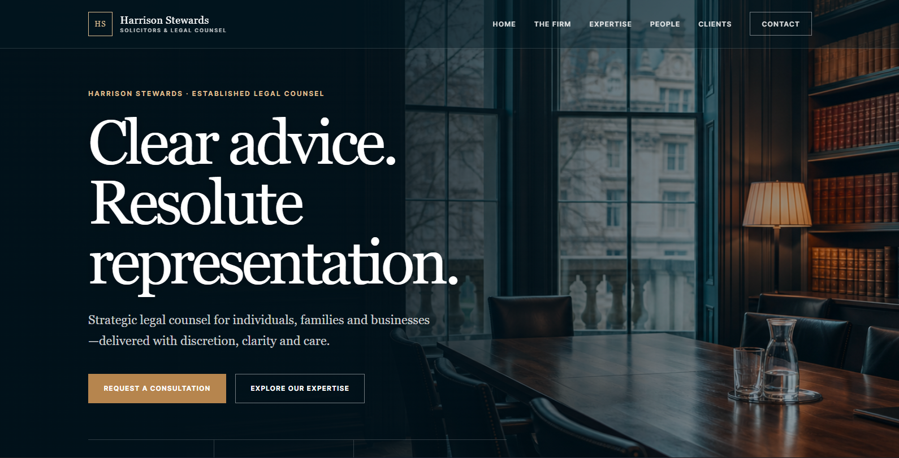
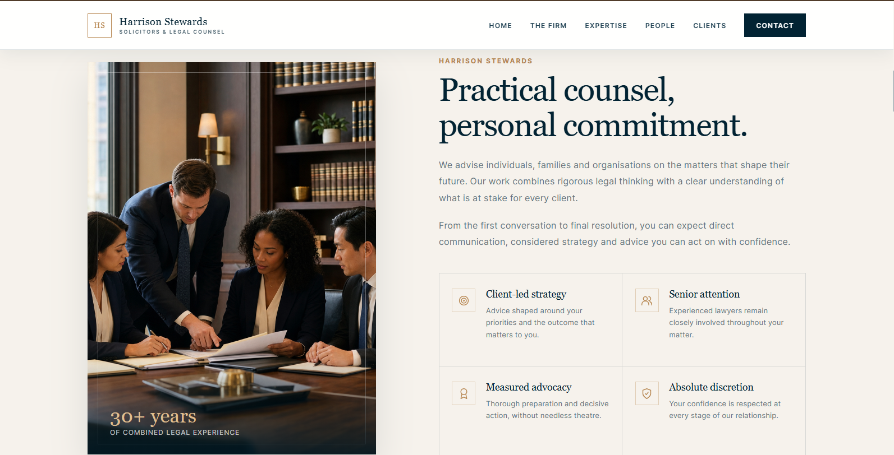
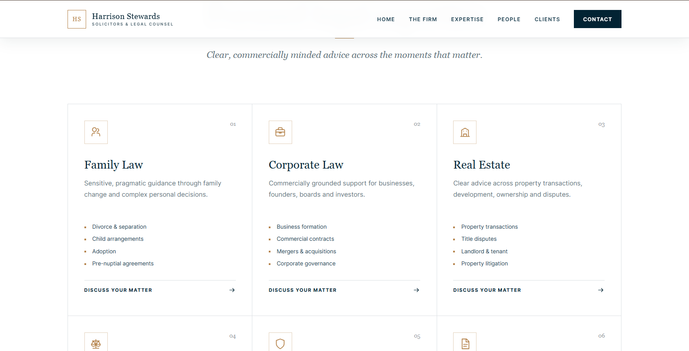
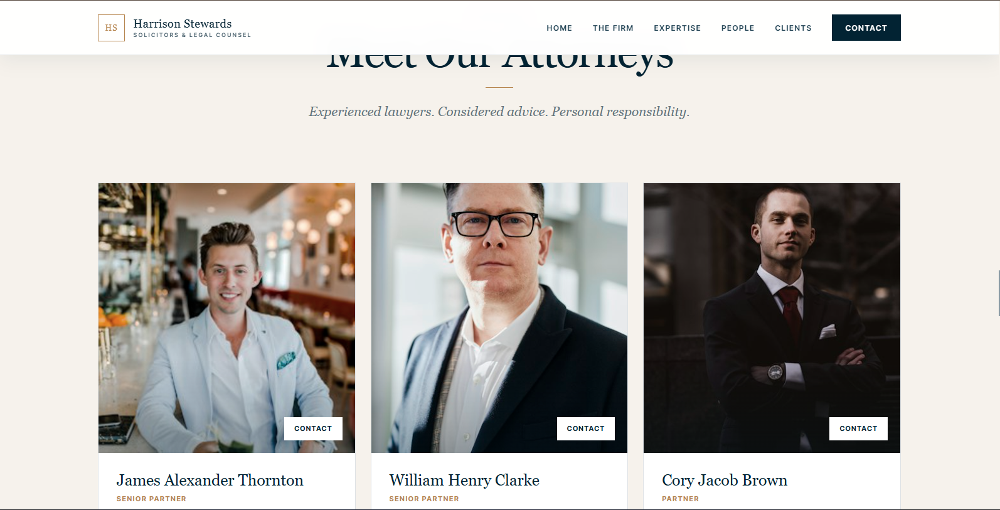
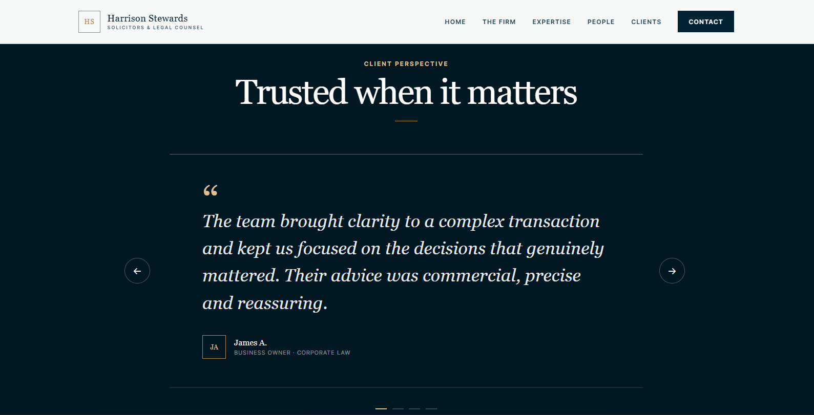
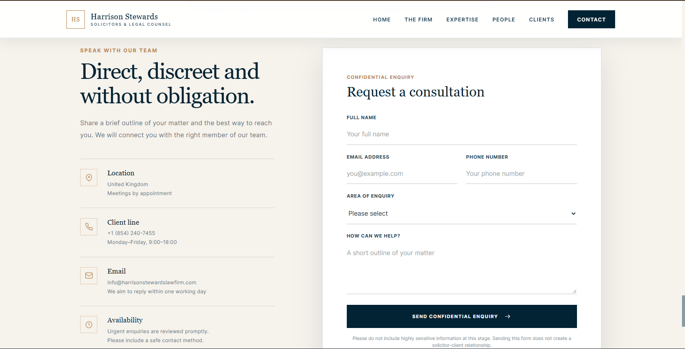

# Harrison Stewards — Law Firm Website

A polished, responsive React website concept for **Harrison Stewards**. The portfolio project presents a refined legal brand through clear practice-area information, attorney profiles, client-perspective cards, and a consultation enquiry interface.

> **Portfolio demonstration:** Firm, attorney, experience, contact, testimonial, and service details are sample website content and should be verified before any real-world use. This project is a front-end portfolio concept, not legal advice or a source of legal services. The contact form is a demonstration; it does not send or store enquiries.

## Preview

| Home | The firm |
|---|---|
|  |  |

| Expertise | People |
|---|---|
|  |  |

| Client perspectives | Contact |
|---|---|
|  |  |

## Project overview

The site is a single-page experience with anchored navigation and a consistent editorial visual style. Deep navy, warm ivory, and muted gold are paired with serif headlines, restrained borders, and spacious layouts to create a formal but approachable presentation.

### Included sections

- **Home:** Brand introduction, primary calls to action, and firm highlights.
- **The firm:** Values, approach, and combined-experience presentation.
- **Expertise:** Seven sample practice areas: family, corporate, real estate, criminal defence, personal injury, private client, and investment law.
- **People:** Sample attorney profiles and contact links.
- **Client perspectives:** A navigable testimonial carousel using fictional sample quotations.
- **Contact:** Enquiry form UI and sample contact information.

### Interaction details

- Sticky navigation styling responds to page scrolling.
- Navigation and calls to action scroll to page sections.
- A collapsible navigation menu supports smaller screens.
- The testimonial section includes previous/next controls and direct slide selection.
- The contact form validates required fields in the browser, shows a demonstration confirmation, and clears its fields. It has no server-side submission or storage.

## Technology

- React 19
- Create React App (`react-scripts`)
- JavaScript and CSS
- React Testing Library and Jest test setup
- Local image assets in `src/assets/`; attorney profile images are loaded from Unsplash URLs.

## Run locally

### Requirements

- Node.js and npm
- Git, if cloning this repository

### Setup

```bash
git clone <repository-url>
cd law-firm
npm install
npm start
```

The development server opens at [http://localhost:3000](http://localhost:3000).

## Available scripts

| Command | Description |
|---|---|
| `npm start` | Starts the local development server. |
| `npm test` | Runs the test runner in watch mode. |
| `npm run build` | Creates an optimized production build in `build/`. |
| `npm run eject` | Exposes the Create React App configuration; this is a one-way operation. |

## Repository structure

```text
law-firm/
├── public/                  # HTML shell, icons, manifest, and public assets
├── src/
│   ├── assets/               # Local hero and firm imagery
│   ├── components/           # Page sections and reusable legal icon component
│   ├── App.js                # Main single-page composition
│   ├── App.css               # Application-level styling
│   └── index.js              # React entry point
├── docs/
│   └── screenshots/          # README preview images
├── .gitignore                # Excludes dependencies, build output, and local env files
├── package.json
├── package-lock.json
└── README.md
```

## Portfolio notes

This implementation is a front-end concept and includes sample marketing copy, lawyer profiles, testimonials, and contact details. The enquiry form currently displays a browser confirmation only. A real deployment would need verified firm information, permission-cleared imagery and quotations, an implemented and secured form service, and an appropriate privacy notice before it could be used to collect enquiries.

## License

No license is currently specified. Add a license file if you want to define how others may use or adapt this project.
